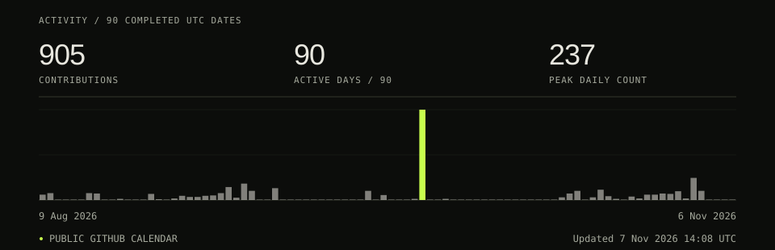
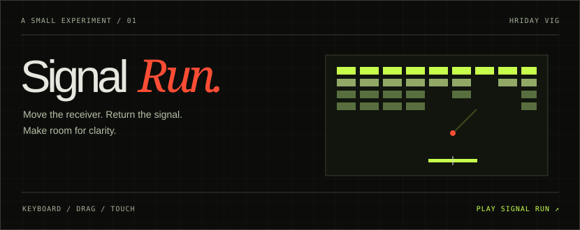

  

I connect ideas, people, and technology to turn complex problems into useful products. I’m a Computer Science undergraduate in New Delhi, with experience across enterprise workflows, cloud platforms, and tools for working with AI.

[Portfolio ↗](https://hridayvig.xyz/) · [LinkedIn ↗](https://www.linkedin.com/in/hridayvig/) · [Email ↗](mailto:vighriday@gmail.com)

## 01 / Selected work

### [Veris](https://github.com/vighriday/Veris)
**Know what changed. Know what was checked.**

A local-first behavioral diff for TypeScript and JavaScript. Connects code changes with their likely reach, verification plans, and recorded evidence through 17 MCP tools and a CLI.

[Source](https://github.com/vighriday/Veris) · [Published package](https://www.npmjs.com/package/veris-core) · [Case study](https://hridayvig.xyz/projects/veris)

### [HIVE](https://github.com/vighriday/hive-agent-security)
**Security for what happens between agents.**

A graph-based prototype for unsafe capabilities that emerge between individually authorised agents. Trace the finding, compare simulated containment options, and inspect the verification in a recorded engine replay.

[Source](https://github.com/vighriday/hive-agent-security) · [Replay console](https://vighriday.github.io/hive-agent-security/console/) · [Case study](https://hridayvig.xyz/projects/hive)

### [OFFSIDE](https://github.com/vighriday/offside-june-2026)
**Explain why the argument persists.**

An evidence-grounded account of disputed football decisions. IBM Granite reads the sources, Granite Guardian audits that reading, and explicit rules assemble the diagnosis. The public reader presents precomputed analyses.

[Source](https://github.com/vighriday/offside-june-2026) · [Evidence reader](https://offside-june-2026.vercel.app/) · [Case study](https://hridayvig.xyz/projects/offside)

<strong>Follow another thread</strong>

- **[Pulse](https://github.com/vighriday/Pulse):** monitor Claude Code sessions, steer tasks, and review tool approvals from a phone.
- **[Scrybe AI & Maniac](https://github.com/vighriday/algorithmic-infrastructure-portfolio):** a public architecture portfolio for quantitative ML infrastructure and multi-agent systems built under BluOryn Technologies Pvt. Ltd.
- **[The full project directory](https://hridayvig.xyz/#work):** personal explorations, enterprise work, and hackathon builds, with the context behind each.

## 02 / Experience, in context

<strong>Work, education, and the tools behind it</strong>

**NIIT Learning Systems Ltd. · Project Intern · July–August 2026** 
Led OCR integration across requirements, architecture, workflow and field mapping, coordination, and testing toward production readiness. Contributed to an internal Network Intelligence Platform and performed AI chatbot UAT.

**BluOryn Technologies Pvt. Ltd. · Platforms Management Intern · September 2025–May 2026** 
Led cloud platform modernization and worked across deployment, infrastructure, lead/CRM workflows, email and WhatsApp automation, and ongoing platform operations.

**Proofr · Startup Catalyst · July 2025** 
Market research, TAM/SAM/SOM analysis, and competitive assessments for India’s early-career hiring ecosystem.

**B.Tech, Computer Science and Engineering · MSIT, GGSIPU · 2024–2028** 
CGPA: **8.86/10**. Currently Sponsorship Department Head at **L.O.O.M**, a student community built around learning, building, mentoring, and contributing.

**Working toolkit** 
Python, Java, TypeScript/JavaScript, SQL, PostgreSQL, SQLite, MongoDB. AI-assisted work with Codex, Claude Code, and Cursor. Delivery with Azure Functions, Docker, Vercel, Neon, GitHub Actions, Dify, and n8n.

[Read the full timeline ↗](https://hridayvig.xyz/#timeline)

## 03 / Activity, in context

Counts come from the publicly visible GitHub contribution calendar. The chart prints its exact window and refresh time. [Inspect the snapshot](data/activity.json).

<strong>One small detour: play Signal Run</strong>

Sixty tiles. One red ball. Follow it through. **[Play Signal Run ↗](https://vighriday.github.io/vighriday/play/)** 
Keyboard and touch controls. This is a standalone game board, separate from the activity chart.

---

*Stay interested after the first answer.* 
[Start a conversation ↗](https://hridayvig.xyz/#contact)
